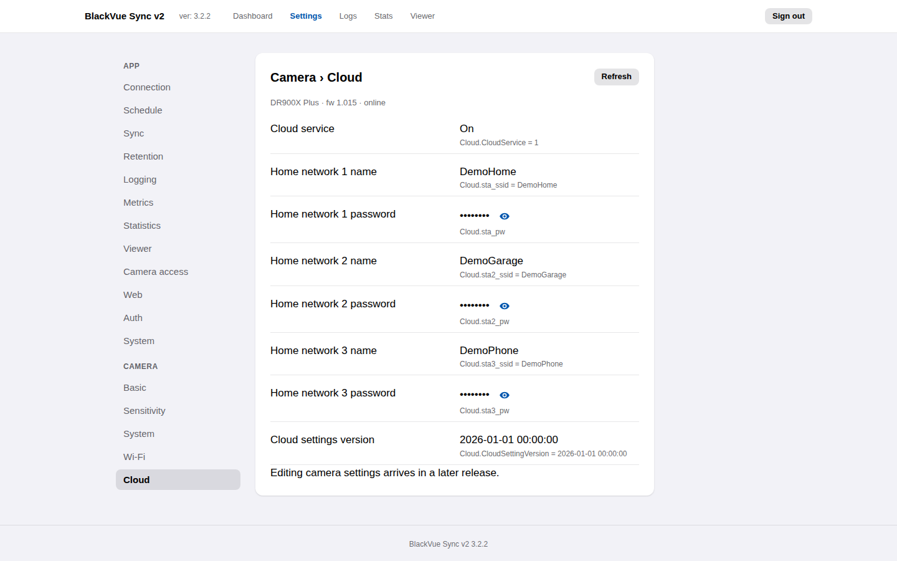
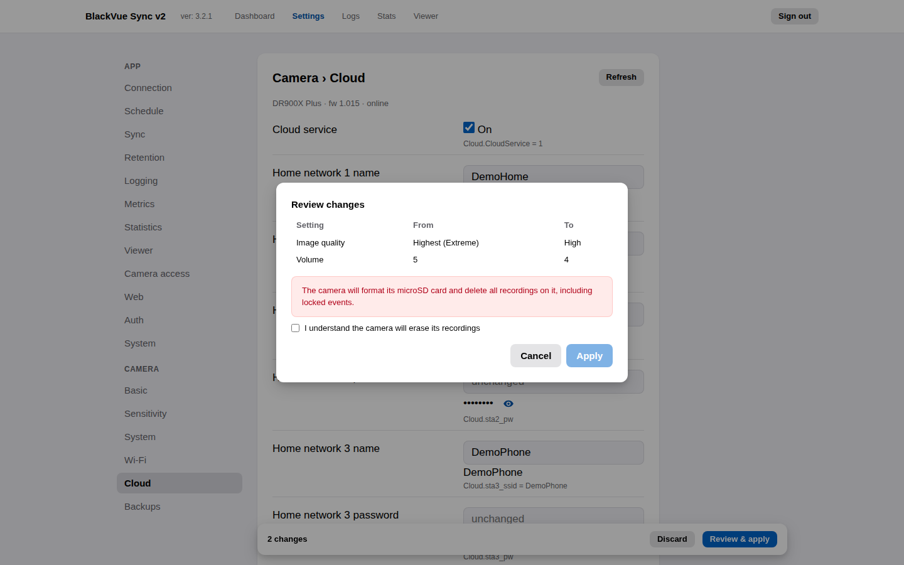

# Camera settings

**Settings → Camera** shows every setting stored on the dashcam itself, grouped
the way the BlackVue app groups them: **Basic**, **Sensitivity**, **System**,
**Wi-Fi** and **Cloud**. You can read them, and change them from here; every
change is backed up first and checked afterwards.

## Reading the camera

The panes read the camera's `Config/config.ini` every time the Settings page
loads, and when you press **Refresh**. They wait up to
`camera.read_timeout_seconds` (see [Configuration](configuration.md#camera-access))
for each of the two files they read, so a slow or absent camera can delay the
panes by up to about twice that. When the car is away, they show the settings
from the last successful read and say when that was.

The app keeps a copy of that settings file under `<config dir>/camera/` (mode
`0600`). It includes the Wi-Fi passwords in the camera's encrypted form, which
anyone can decrypt with the public BlackVue key, so treat that folder like the
camera itself when sharing backups or bug reports.

If you change a setting in the BlackVue app and press **Refresh**, the panes
list what changed on the camera since the last read.

## Wi-Fi passwords

The camera hotspot password and the three home-network passwords are masked.
Select the eye icon to show one; select it again to hide it. The camera stores
these passwords encrypted with a key built into the BlackVue app. That key is
public, so the app treats them like any other secret: masked by default, never
logged, never sent unless you ask to see one.

Keys that the app does not know but that are named like passwords (ending in
`_pw`, or containing `password`, `passwd` or `pwd`) are masked too, so a future
firmware cannot leak one by adding it.

If authentication is off (`auth.mode` `none`), anyone who can open the app can
reveal them. That is no wider than the camera itself, which serves its settings
file to anyone on your network.

## Changing settings

Edit any control in a pane. Nothing is sent yet: edits are staged in the page,
and a bar at the bottom shows how many settings you have changed, with
**Discard** and **Review & apply**. A fresh read of the camera (the Refresh
button) replaces staged edits.

**Review & apply** opens a dialog listing each change as setting, from and to.
Passwords only show that they changed. Select **Apply** and the app:

1. reads the camera's current `config.ini` again, so it never overwrites a
   change made in the BlackVue app a moment ago;
2. saves that file as a backup;
3. uploads the patched file to the camera. Most changes take effect without
   a restart (a volume change on a DR900X Plus verified in 0.2 s); the time
   settings and image quality restart the camera and format its card, see
   [below](#settings-that-erase-recordings);
4. waits for the camera to answer again and reads the settings back,
   comparing both the values and the file's bytes.

This takes up to `camera.verify_timeout_seconds` (default two minutes; see
[Configuration](configuration.md#camera-access)). The dialog then reports one
of these outcomes:

* **Applied and verified**: the camera came back and holds every value you
  set, and its file is exactly what the app sent.
* **Applied: the camera holds every value you set, but it rewrote the file**:
  the values are right, but the firmware changed the file's bytes elsewhere,
  so the next read of the Camera pane may show differences.
* **Applied, but the camera's settings could not be verified**, with
  **The camera kept its own value for:** and a list of keys: the camera came
  back but its firmware changed or rejected those values. The other changes
  took effect. See [Troubleshooting](troubleshooting.md#the-camera-kept-a-value).
* **Applied, but the camera has not come back yet**: the upload went through
  but the camera did not answer within the wait. See
  [Troubleshooting](troubleshooting.md#the-camera-did-not-come-back-after-applying).

When the camera drops the connection before it acknowledges the upload (it may
restart first), the app does not call that a failure: it waits and verifies as
usual, and the dialog adds "The camera did not acknowledge the upload; the
result below is what it reports now." Only a camera that answers with an error
fails the upload outright. If the camera then still holds every old value, the dialog says the change
did not take effect.

The apply is a single long request, up to `camera.upload_timeout_seconds` plus
`camera.verify_timeout_seconds` plus two camera reads (about 3 minutes with the
defaults). Set a reverse proxy's timeout above that; a shorter one may cut the
connection, but the apply keeps running on the server. Press **Refresh** on the Camera pane to see the
result.

Password fields start empty and an empty field means unchanged: there is no
control for clearing a camera password. A password you reveal with the eye icon
only counts as a change once you edit it, and hiding it again empties the field.

Changing the Wi-Fi or cloud settings can leave the camera unreachable from
here (a wrong network name, for example). The dialog warns you; keep the
backup in mind (below).

### Syncs and applying

Applying holds the same lock a sync uses, so a scheduled sync never runs
against a camera that is restarting. A scheduled sync that falls due while
you apply is skipped, and the next one runs as normal. If a sync is already
running when you select **Apply**, the apply is refused with "a sync is
running" and nothing is changed; try again when it finishes.

## Settings that erase recordings

Settings marked **erases camera recordings** (the time settings and image
quality) make the camera restart and format its microSD card when they are
changed: the BlackVue manual says it deletes all recordings on the card,
locked events included. They are the only settings that restart the camera. This is a warning you can accept, not a block, because changing
the time zone is a legitimate thing to do.

When you stage one of these, the review dialog shows a red warning and counts
the recordings that are still only on the camera: those the sync has not
downloaded yet (after your include and exclude filters). To apply you must
tick **I understand the camera will erase its recordings** and, when the
count is above zero, **I accept losing N recordings**. If the camera cannot
be listed to count them, **Apply** is refused until it can.

The safest order is to select **Sync now first** (the link in the dialog),
wait for the sync to finish, then review and apply: with nothing left to
lose, only the first tick is needed. The same rule applies if you change
these settings in the BlackVue app: the app cannot stop that.

## Backups and restore

Before every apply the app saves the camera's current `config.ini` to
`<config dir>/camera/backups/` (the folder next to `settings.json`, mode
`0700`, files `0600`). It keeps the newest `camera.backup_count` copies
(default 10) and deletes older ones. The files contain the Wi-Fi passwords in
the camera's encrypted form, so treat the folder like the camera itself.

**Settings → Camera → Backups** lists them, newest first, with a **Restore**
button. Restoring opens the same review dialog, listing the settings that
differ from the camera's current file, and goes through the same backup,
upload and verify steps (so a restore is itself backed up and can be undone).
A backup that differs in time or image-quality settings brings the card
warning with it. A backup identical to the camera's current settings is
refused: there is nothing to restore. Read-only keys (such as the cloud
settings version) are never restored, and a restore differing only in
those counts as nothing to restore.

## If the camera does not come back

Most of the time the camera restarts within a minute. If the dialog says it
has not come back, wait a few minutes, then press **Refresh**. If it stays
unreachable, for example after a wrong Wi-Fi change, join the camera's own
hotspot with the BlackVue phone app and correct the setting there, or reset
the Wi-Fi from the camera's own menu. Once it is reachable again you can
restore a backup from here.
